# Platypus progress

Where Platypus stands on **2026-10-27**: what exists, a picture of every example, the benchmark headline and what comes
next. The plan with every item is [TODO.md](../TODO.md); how the code works is [docs/README.md](README.md).

## What exists

- **UI and CSS** (M2, M3a-d): React through Platypus's own reconciler, Taffy layout (flex, grid), Parley text with font
  fallback, text fields with clipboard and IME, stylesheets with the cascade, custom properties, `@media`, `@font-face`,
  transitions and `@keyframes`, pseudo-elements, filters, masks, blend modes and backdrop blur, inline SVG and SVG images
  (resvg), pointer, keyboard, focus, gamepad navigation, scrolling and drag and drop. UI also draws on planes in the 3D
  world (`WorldPanel`).
- **Rendering** (M5.a, M5.c, M7 fog): a wgpu renderer. PBR (metallic and specular), material maps and rendering modes, a
  procedural sky, reflection probes and planar mirrors, directional cascades and spot / point shadows, bloom and glows,
  tonemapping, exposure, auto exposure and real-world light units, MSAA, FXAA and render scale, render textures, layers,
  culling masks, frustum culling and LOD, particles, 2D lines, shapes, sprites and `TextMesh`, distance and height fog
  and volumetric light shafts. Quality levels switch these per machine.
- **Physics** (M4, M5.a2): rapier in 3D and 2D: bodies, colliders (mesh colliders from models), character controller,
  joints, rope and cloth.
- **Audio** (M4): kira: decoded and streamed sounds, buses, spatial emitters, `AudioSource` / `AudioListener`.
- **Animation** (M5.d): curves and clips, `Animation`, `Animator` with blend trees and transitions, glTF skinned meshes with
  GPU skinning, animation culling, splines and `SplineAnimate`.
- **Scenes** (M5.b): JSON scene files, `SceneManager` (single, additive, async), prefabs, `instantiate`,
  `dontDestroyOnLoad`, hot reload that keeps the scene.
- **Windows**: more OS windows from TypeScript (tools, dialogs, isolated windows with messages), each with its own UI.
  Checked with a fake platform and screenshot runs; the multi-window runner has not been run on a real display.
- **Assets and packs**: GUID `.meta` files, asset hot reload, cooked textures and models, `.ppk` packs (LZ4 or zstd) under
  a virtual file system.
- **The native compiler** (M9): `platypus_ts` compiles a game's TypeScript (oxc parser, a typed IR, Cranelift) with a
  precise garbage collector, closures, classes, async / await, Map / Set, JSON, RegExp and Intl (ICU4X). The engine API
  is Rust annotated with `#[platypus_api]`, which also generates the game's TypeScript declarations
  (`types/platypus.d.ts`), so there is no hand-written `.d.ts`. `platypus-build` builds, checks, packages (one `.exe`
  with the game as a payload, its icon and version info; the Platypus icon when a game has none) and benchmarks games.
- **Benchmarks**: `platypus-build bench` measures every example natively and against its QuickJS original.
- **QuickJS** (the first script backend) is deprecated: the host refuses a QuickJS bundle unless `--force`. Only the
  editor still runs on it.
- **The editor** (M5.e) is in progress: menubar, docking, console, project browser and a Scene view with gizmos; the
  Inspector, undo / redo and the manual checks of its controls are not done.
- **Platforms**: developed and tested on Windows (Vulkan by default, DX12 optional). Linux and macOS are untested.

## Benchmarks

Native (`platypus_ts`) against the QuickJS original of each example, release host, windowless, 1280x720, fixed step
(final run of 2026-10-23, details in [benchmarks.md](benchmarks.md)):

- Script-heavy examples gain the most: raindrop-demo 7.22x, fishtank 5.37x, godrays-room 4.88x, world 4.45x, splines
  3.38x, physics 2.57x; their script time is 20-75x lower. Nothing is slower than QuickJS beyond the noise between runs.
  GPU-bound scenes are equal.
- Start-up, process start to first frame including the JIT compile: 0.42-0.67 s for most examples.
- A pure script micro-benchmark (the game-rules simulation, 10,000 steps): QuickJS 391 ms, bun (JavaScriptCore JIT) 36.1 ms,
  `platypus_ts` 9.1 ms ([platypus-ts-native.md](platypus-ts-native.md)).

## Examples

One picture per example, from a windowless run of the release build (how to make them again: below). Each example's
own README says how it works.

| Example | Picture |
|---|---|
| **animation**: an Animator blend tree, a glTF skinned mesh and a skinned mesh built in code | 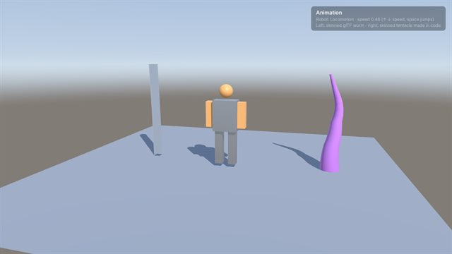 |
| **arcade**: a small complete game: React HUD, two scenes, settings menu, PlayerPrefs | 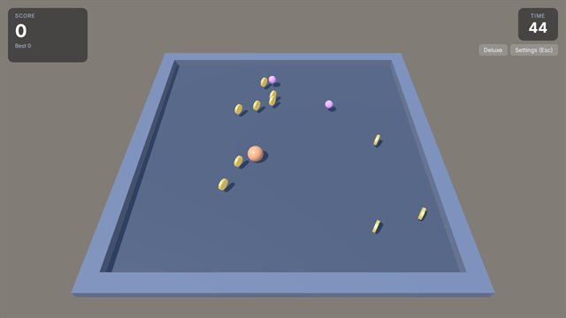 |
| **boxes**: the UI box model: flex and grid, gradients, shadows, blur | 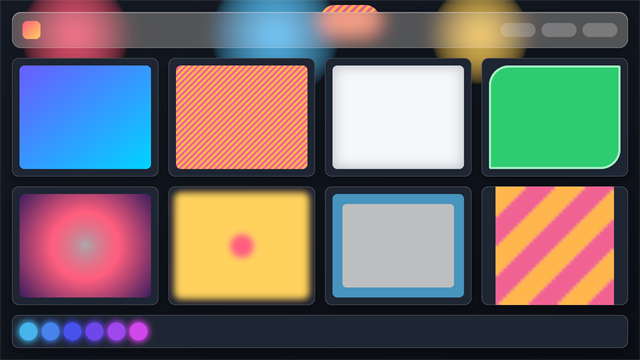 |
| **classics**: the Stanford Bunny and the Newell teaset (glTF) under lights | 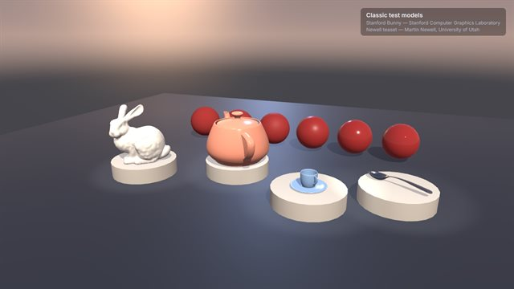 |
| **clock**: twelve clock faces in 2D and 3D with a React switcher (the first, Analog) | 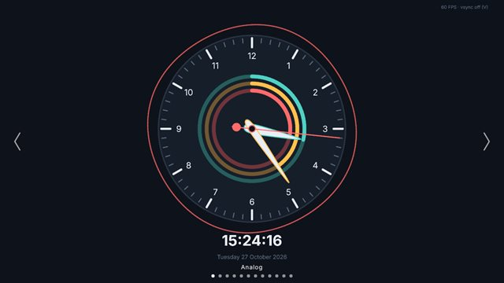 |
| **cloth**: cloth simulation: a flag, a tablecloth, a curtain | 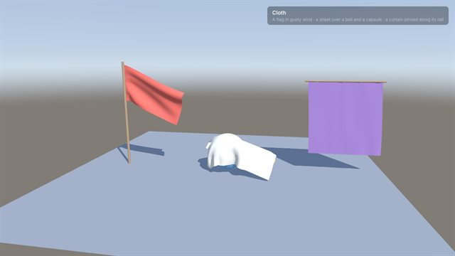 |
| **cornell**: the Cornell box with faked bounce lighting | 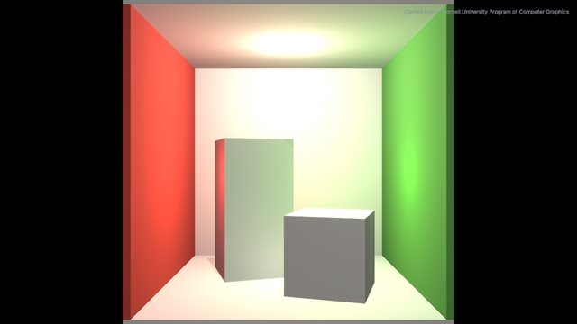 |
| **crowd**: hundreds of animated mannequins round two city blocks, animation and frustum culling | 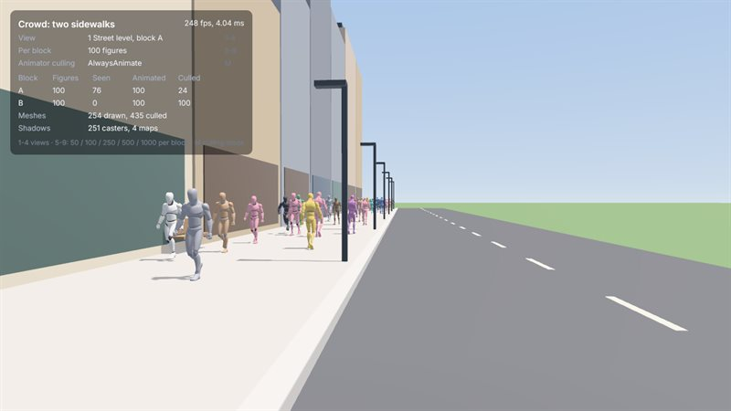 |
| **css**: stylesheets: selectors, pseudo-classes, `var()`, `@font-face`, `clip-path` | 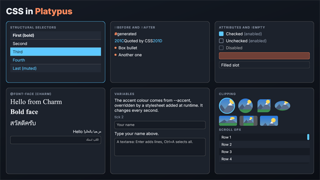 |
| **dark-room**: eye adaptation as shutters open on a dim bedroom | 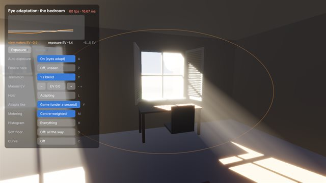 |
| **emoji**: a self-running stage show: a spinner picks one of 50 SVG emoji |  |
| **fishtank**: an aquarium: boids, fog, procedural 2.5D scenery | 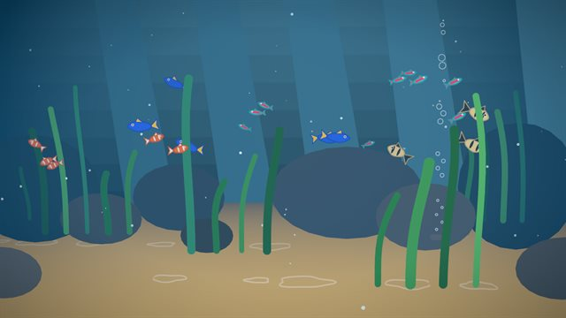 |
| **fog**: fog modes, height fog and volumetric light shafts in a misty clearing | 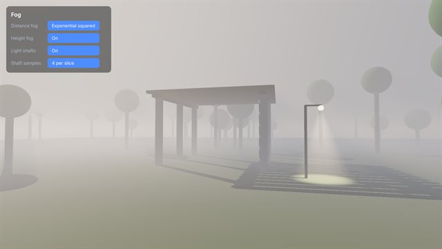 |
| **fog-blocks**: a blocky hill in sky-blue fog under a cloud deck | 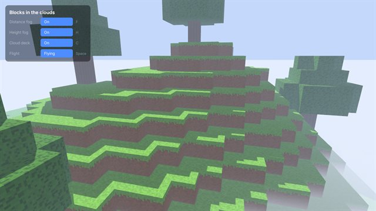 |
| **fog-park**: a Victorian London park built from primitives, mist by morning | 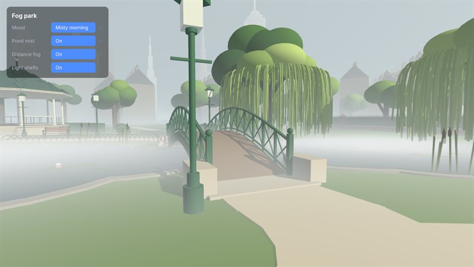 |
| **fog-raider**: a PS1-style tomb with black fog a few metres away | 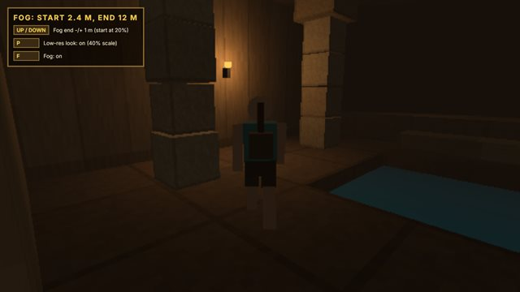 |
| **fog-teapots**: teapots on a mirrored checkerboard receding into fog | 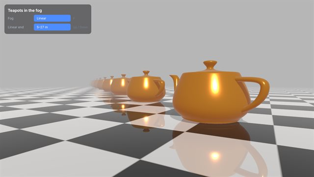 |
| **fog-white-room**: a white mannequin on an endless tiled floor melting into white fog | 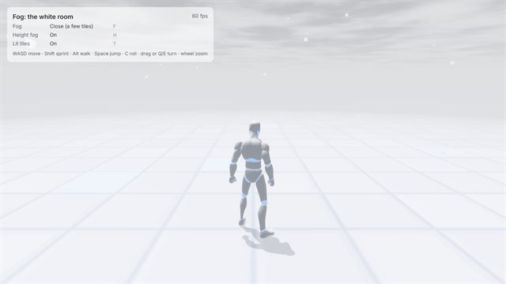 |
| **fog-world**: an endless streamed block world where the fog is the render distance | 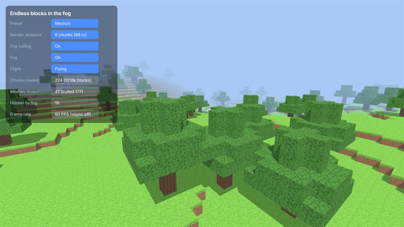 |
| **form**: controlled inputs, validation, keyboard and gamepad navigation | 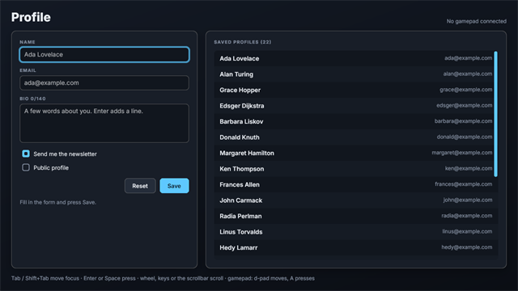 |
| **godrays-cell**: beams through a barred prison window, with dust | 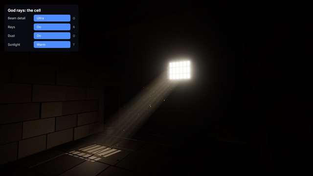 |
| **godrays-clouds**: crepuscular rays through a cloud layer over fields | 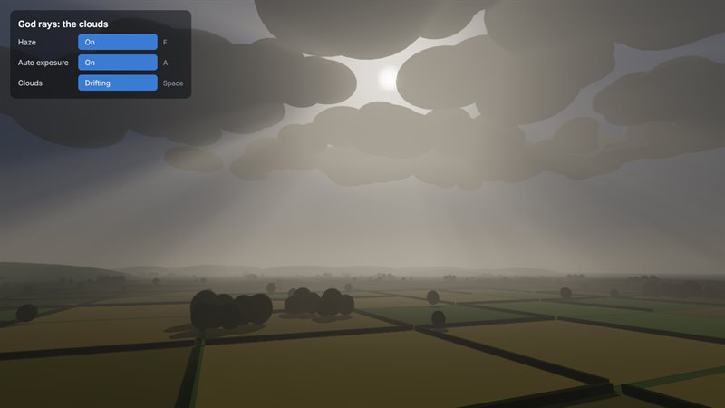 |
| **godrays-forest**: beams through a forest canopy | 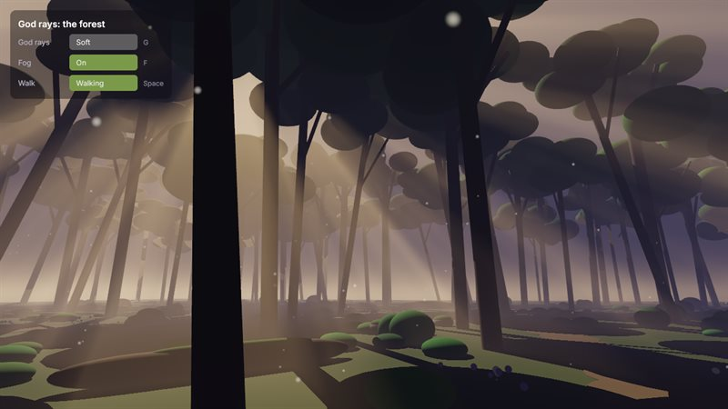 |
| **godrays-lift**: lift doors open on a dark hotel corridor | 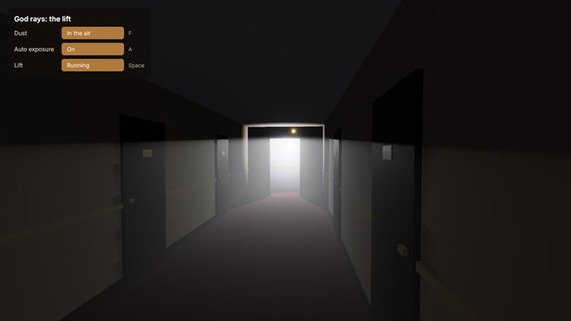 |
| **godrays-room**: a derelict hall, light through a broken roof, a window and shutters | 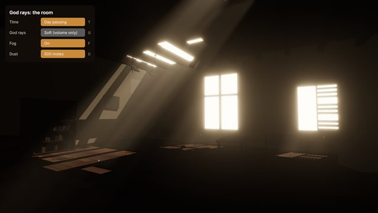 |
| **godrays-shed**: a craft's scanning beam sweeping a dusty garden shed | 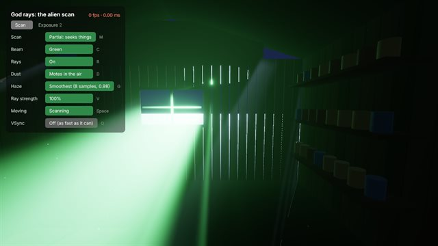 |
| **godrays-sunset**: a 25th-floor flat over a city as the sun sets | 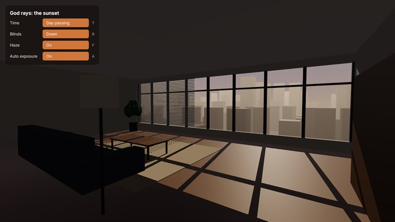 |
| **hello**: the smallest project, one component and a `src/modules` import; it only logs, so there is no picture | |
| **launcher**: a game launcher mock-up: the examples as a carousel, mouse, keys or gamepad | 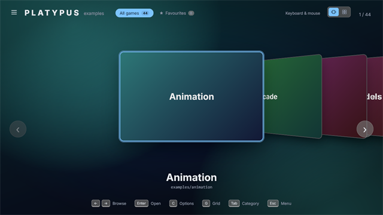 |
| **layers**: layers, culling masks, a minimap camera, `LODGroup` | 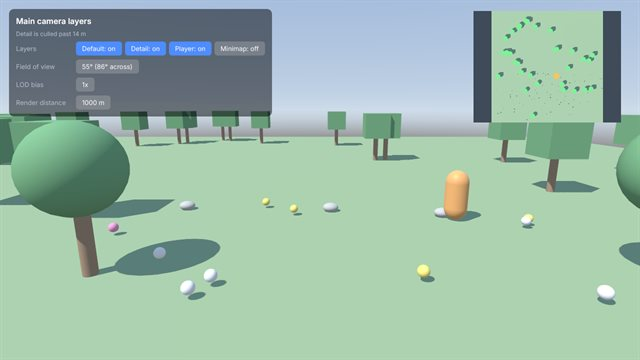 |
| **light-units**: real-world light units (lux, lumens) and exposure, here the lamplit hall | 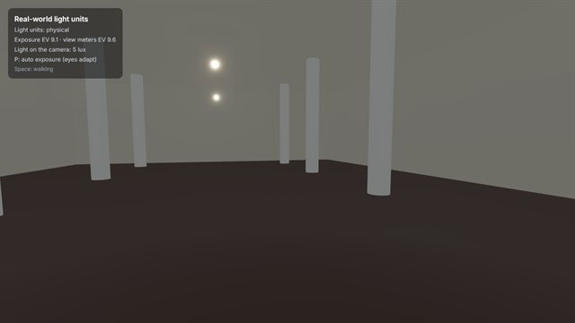 |
| **materials**: a PBR material showroom with mirrors and reflection probes | 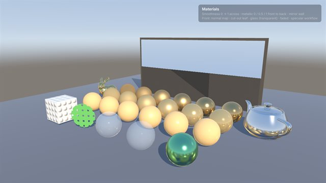 |
| **md-reader**: a Markdown reader for Platypus's own docs, drawn by Platypus's UI | 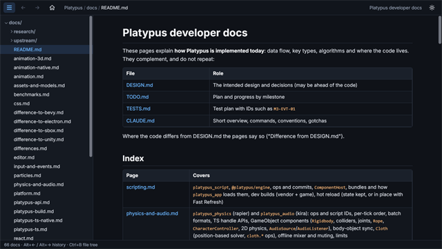 |
| **physics**: rapier bodies drawn as UI boxes, with collision sounds | 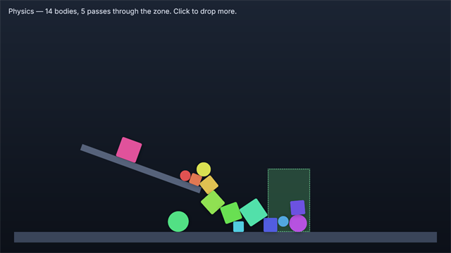 |
| **platformer**: Fox Run, a 2D platformer: sprites, `Rigidbody2D`, a follow camera | 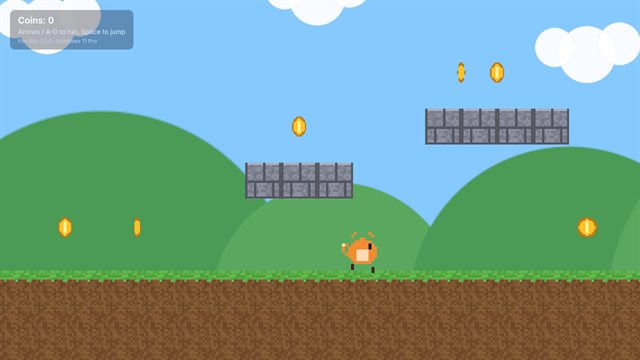 |
| **quality**: quality levels and a graphics settings menu | 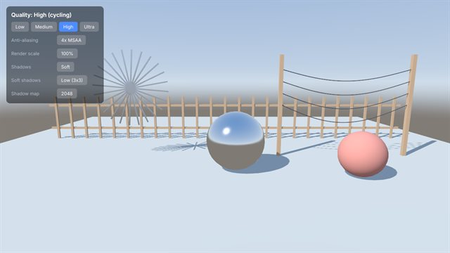 |
| **raindrop-demo**: rain ripples from procedural sprites, weather modes, music (a MiniGameEngine port) | 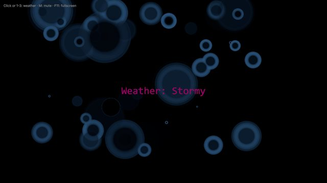 |
| **scenes**: JSON scenes, `SceneManager`, `dontDestroyOnLoad`, level switching | 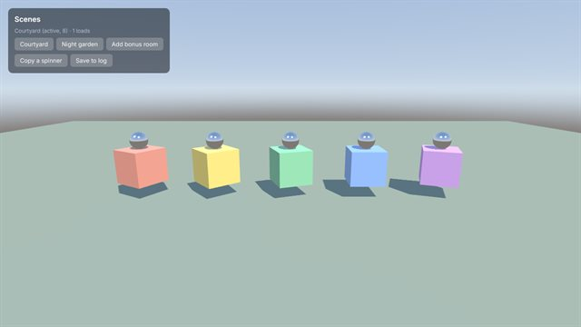 |
| **shapes**: `LineRenderer2D` and the `Shapes` 2D vector gallery | 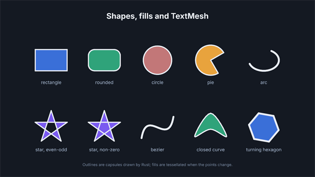 |
| **sine-circle-demo**: a tweened generative curve with streamed music (a MiniGameEngine port; starts paused) | 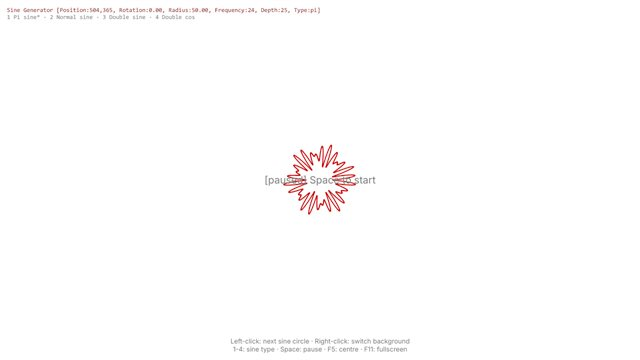 |
| **splines**: `Spline`, `SplineAnimate` and a mouse-driven spline editor | 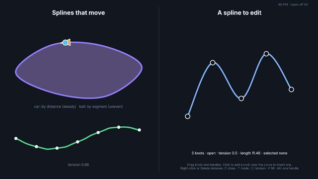 |
| **text**: text styles, runtime fonts, CJK and emoji fallback | 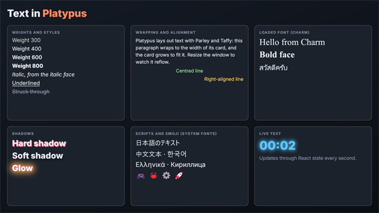 |
| **tunnel**: auto exposure in a road tunnel, dark inside, the exit a white blaze | 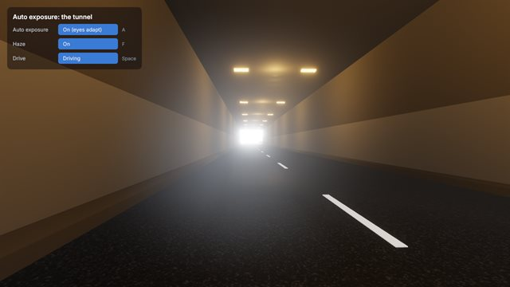 |
| **windows**: several OS windows, each with its own UI (the main window shown; the others are separate windows) |  |
| **world**: a 3D tour: cameras, lights, `WorldPanel`, glTF, rope, particles, spatial audio | 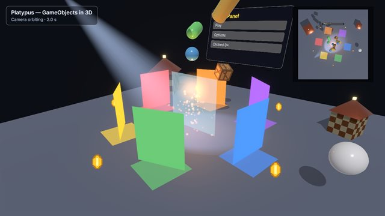 |

## What is next

From [TODO.md](../TODO.md) and [tools/platypus_ts/TODO.md](../tools/platypus_ts/TODO.md):

- **A dynamic `any` / `unknown`** in the compiler, as close to TypeScript as possible, with statically typed code keeping
  its fast path (design: [research/platypus-dynamic-values.md](research/platypus-dynamic-values.md)).
- **Unsafe asset paths**: the prompt for a game that loads files outside its declared assets
  ([research/platypus-virtual-fs-plan.md](research/platypus-virtual-fs-plan.md)).
- **A compile cache**, so a game's start-up skips the JIT compile when the code has not changed
  ([research/platypus-ts-startup-and-hot-reload.md](research/platypus-ts-startup-and-hot-reload.md)).
- **A code review pass** over the compiler branch once it is merged (TODO.md, "Code review").
- **The editor** (M5.e): the manual check of the Scene view, an Inspector bound to the scene, undo / redo; then script
  IO (M6: files, fetch, WebSocket) and multiplayer (M8).

## Making the pictures again

Windowless runs (`--bench`: an offscreen target, no OS window opens), a fixed step of 1/60 s so each picture is the same
moment of the game's clock on any machine, 120 frames in, more where an effect needs time to settle (fog and god rays
600, the eye-adaptation bedroom 900, the tunnel 420), then shrunk to 640 px (800 for a few showpieces) as JPEG at
quality 85, PNG for UI examples. The shrinking uses Windows PowerShell's System.Drawing.

```bash
cargo build --release -p platypus_app
cd tools && cargo run -q -p platypus_build -- check ../examples && cd ..
bun scripts/progress-shots.ts            # every example; or name some: bun scripts/progress-shots.ts fog tunnel
```

The full-size renders and each run's bench JSON stay in `tests/output/progress/` (git-ignored). Look at every picture
before committing: an example that needs input, or a random one (emoji), can catch an odd moment.
