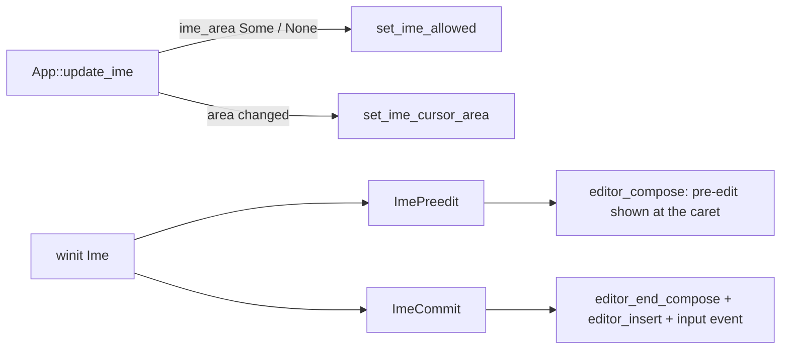

# Input and events

Crates: [iron_platform](../crates/iron_platform/src) (OS input),
[iron_ui](../crates/iron_ui/src) (`events.rs`, `interaction.rs`, hit testing in `tree.rs`), glue in
[iron_app/main.rs](../crates/iron_app/src/main.rs), JS side in [react.md](react.md). Test plan:
M3-EVT-* in [TESTS.md](../TESTS.md).

## End to end

## Platform layer

[input.rs](../crates/iron_platform/src/input.rs) converts winit's `WindowEvent` to Iron's own
`InputEvent` so nothing above this crate depends on winit:

- Keys use DOM naming: `code` is the physical key (`"KeyW"`, from winit's `KeyCode` debug name),
  `key` is the layout meaning (`dom_key`: characters as typed, `Space` -> `" "`, `Super` -> `"Meta"`,
  other named keys by their name), `text` is the typed text without control characters, plus `repeat`.
  `convert_key` is split out because winit's `KeyEvent` cannot be built in tests.
- Mouse: `MouseMove{x,y}` in **physical** pixels, `MouseDown/Up{button}`, `MouseLeave`, and
  `MouseWheel(WheelDelta)`. winit's wheel deltas are positive when scrolling up; the code negates
  them to the DOM convention (positive y = scroll down). `Lines` (notched wheels) and `Pixels`
  (touchpads) stay distinct.
- `Ime(ImeEvent)` for input methods: `Enabled`, `Preedit(text, cursor)` (cursor/selection as byte
  offsets, `None` hides the caret, empty text ends composing), `Commit(text)`, `Disabled`. winit only
  sends these after the app calls `set_ime_allowed(true)` (see below).
- `Modifiers`, `Resized`, `Focused`, `CloseRequested`.
- `Gamepad { id, event: GamepadEvent }` (see [Gamepads](#gamepads-and-game-input-m3c-step-6)).

[platform.rs](../crates/iron_platform/src/platform.rs): `Platform::run` owns the winit event loop.
`Runner` implements `ApplicationHandler`: creates the window in `resumed` (then
`PlatformApp::window_ready`), calls `PlatformApp::frame` on `RedrawRequested`, forwards converted
events to `PlatformApp::input`, and in `about_to_wait` checks `should_exit`, polls gamepads and
requests the next redraw (continuous rendering). `Platform::poll_gamepads` drains `gilrs` and
returns `InputEvent::Gamepad`s, which the runner feeds to `PlatformApp::input` like any other
event. `iron_platform` re-exports `winit::dpi` so the app can build
IME area arguments.

## App glue ([main.rs](../crates/iron_app/src/main.rs))

`App::input` maps `InputEvent` to `iron_ui::Input` and calls `handle_ui`:

- Positions are divided by the window scale factor (logical pixels). `Lines` wheel deltas are
  multiplied by `WHEEL_LINE` (40 px), touchpad pixels are divided by scale.
- Buttons become DOM numbers via `dom_button` (0 left, 1 middle, 2 right, 3/4 back/forward).
  `PointerDown` carries `time_ms` (engine clock) for double-click detection.
- `Focused(false)` becomes `Input::WindowBlur`, so buttons held while the window was unfocused
  are forgotten (their release may never arrive).
- `handle_ui` calls `Interaction::handle(tree, input, &mut |event| dispatch(...))`, then reads
  `Interaction::cursor` and updates the OS cursor only when the CSS keyword changed
  (`set_cursor_visible(false)` for `none`; otherwise it parses the keyword into winit's
  `CursorIcon`).
- `dispatch(scripts, enabled, event)` calls `__iron_ui_event(...)` with `UiEvent::script_args()` via
  `call_global`; it returns `true` only if the JS result is `Bool(true)`, i.e. a handler called
  `preventDefault()`. JS errors are logged and treated as "not prevented". If the game has no
  `__iron_ui_event`, nothing is dispatched but built-in behaviour (hover, focus, Tab) still works.
- `KeyDown` forwards `text` (what the key types). `InputEvent::Ime` becomes `Input::ImePreedit` or
  `Input::ImeCommit`; `Ime::Disabled` becomes an empty `ImePreedit` (ends composing).
- After each `handle_ui`, `Interaction::take_clipboard()` is serviced and `update_ime` runs (see
  [Text fields](#text-fields-m3c-step-5)); `frame()` also calls `UiTree::set_time(now_ms)` (caret
  blink) and `update_ime` (the caret may have moved with layout).
- Script ops `focus`, `blur` (and `scrollTo`, `scrollBy`, `scrollIntoView`, which map to `Input::ScrollTo/ScrollBy/ScrollIntoView`) are
  turned into `Input` values in `App::tick`. At the end of each tick the app sends `Input::Refresh`.

## Hit testing ([tree.rs](../crates/iron_ui/src/tree.rs) `hit_test`)

`UiTree::hit_test(x, y)` first calls `layout_if_needed`, then `hit(ROOT, ...)` recursively:

- `position: fixed` nodes are tested first, in reverse paint order, ahead of the normal tree.
  `display: contents` nodes are never the target (their children are tested) but stay in event paths.
- Children are tested before their parent, **later siblings before earlier ones** (reverse paint
  order, i.e. `paint_order`: `zIndex`, then `order`, then DOM order). Children outside their parent's box can still hit (no automatic clipping unless the
  parent clips).
- `display: none` returns nothing. The element's own `clip-path`/`clip` and, for children, its
  `overflow` clip must contain the point: **what is clipped away cannot be hit**, using the same
  `self_clips`/`overflow_clip` functions as drawing, so hit testing and painting stay in sync.
- `pointerEvents: none` is inherited and children can opt back in with `auto`.
- The element's own rounded rectangle is respected (`Rect::contains_rounded`).
- `text`/`span` children are not searched (`is_inline_container`): text hits the text element.
  Generated `::before`/`::after` nodes resolve to their originating element.
- `ROOT` never hits; the result `None` means "empty space".

`event_path(target)` returns the target first, then each ancestor, excluding the root: the exact
array sent to scripts.

## `Pointer` ([events.rs](../crates/iron_ui/src/events.rs))

Holds the position (`None` when outside the window), the hovered `path`, held button bitmask,
per-button press targets, the `:active` path, the last press (for click counting) and modifiers.
Each method updates `:hover`/`:active` on the tree (via `update_state` -> `UiTree::set_state`, which
queues restyle keys, see [css.md](css.md)) and **returns the events to dispatch, in order**.

- `rehover` hit-tests and diffs paths: `pointerleave` for elements left (innermost first), then
  `pointerenter` for elements entered (outermost first), each with a one-element path since
  they do not bubble. Every ancestor on the path gets `:hover`, like CSS.
- `move_to` -> rehover + `pointermove`. `leave` clears the position.
- `down`: updates the buttons, records the press target, computes the click count (same target and
  button, within `DOUBLE_CLICK_MS` = 500 ms and `DOUBLE_CLICK_DISTANCE` = 4 px), sets `:active` on
  the whole path for the primary button, emits `pointerdown`.
- `up`: clears `:active`, emits `pointerup`, then `click` (primary), `dblclick` when the count is 2,
  or `contextmenu` (secondary). The click target is the **nearest element containing both the press
  and the release** (DOM semantics), so dragging off and back still clicks the common ancestor.
- `wheel(dx, dy)` -> rehover + `wheel` at the hovered path.
- `refresh` re-hit-tests without movement (the layout changed under a still cursor).
- `cancel` forgets held buttons.

`UiEvent` carries the DOM-like fields (position, `button`, `buttons` bitmask 1/2/4/8/16, `detail`
click count, wheel deltas, modifiers, key/code/repeat, focus `related`, optional `ScrollInfo`).
`script_args()` builds `[type, path, data, strings?]` where `data` is a fixed-order number array:
`[x, y, button, buttons, detail, deltaX, deltaY, modifiers, repeat, related, scrollLeft, scrollTop,
scrollWidth, scrollHeight, clientWidth, clientHeight]`, with `strings = [key, code]` for keyboard
events and `[value]` for `input` events (`UiEvent.value`). [events.ts](../js/react/src/events.ts) decodes by index, so both must change together.

## `Interaction` ([interaction.rs](../crates/iron_ui/src/interaction.rs))

`Interaction::handle(tree, input, dispatch)` is the single entry point (also used by tests, which
pass a closure that records events). It owns a `Pointer`, the focused node, modifiers, a
`keyboard` flag and scrollbar drag state. `dispatch` returns whether the script prevented the
default; **default actions run after the script sees the event**, like a browser.

| Input | Events sent | Default action (unless prevented) |
|---|---|---|
| `PointerDown` primary | `pointerdown` | Focus the nearest focusable ancestor on the path, else blur (a press on empty space blurs). `:focus-visible` is not set for pointer focus |
| `PointerUp` | `pointerup`, `click`, ... | none |
| `Wheel` | `wheel` | Scroll the nearest scrolling ancestor (Shift turns vertical into horizontal) |
| `KeyDown` | `keydown` to the focused element only | `Tab`/`Shift+Tab`: move focus (sets `:focus-visible`); other keys scroll (arrows, Page, Space, Home/End) |
| `KeyUp` | `keyup` to the focused element | none |
| `Focus(id)` / `Blur(id)` (from `ref.focus()`) | `focusout` then `focusin` | `Focus` ignored if not focusable; `:focus-visible` only if the last focus move was by keyboard (browser heuristic) |
| `Navigate(dir)` | `focusout`/`focusin` (via `set_focus`) | Moves focus to `nearest_in_direction` and scrolls it into view; nothing if no element has focus. Sets `:focus-visible` |
| `Activate` | `click` on the focused element | Skipped for text fields. No pointer position, `detail` 0 (like a keyboard-activated click) |
| `Refresh` | hover events | drops focus from removed, hidden or disabled elements |

Focus details:

- `focusable(tree, id)`: has a tab index (`tab_index`: the `tabIndex` attribute, or 0 for text fields,
  which are focusable by default like in HTML), not `disabled`, and `is_displayed` (no `display: none`
  ancestor). Plain `<box>`es without `tabIndex` are never focusable.
- `tab_order(tree)`: depth-first in tree order skipping generated nodes and `display: none`
  subtrees; positive `tabIndex` first (ascending, stable), then `tabIndex = 0` in tree order;
  negative values are skipped (focusable by click or `ref.focus()` only). `tab_target` wraps around.
- `set_focus` updates `ElementState.focus/focus_visible` and sends `focusout` (with `related` = the
  new target) to the old element, then `focusin` (with `related` = the old one). Both bubble, so
  `onFocus`/`onBlur` on a parent see descendants gaining/losing focus; `:focus-within` is handled
  by the cascade scanning descendants (`Deps.focus_within`).
- Key events with no focused element are not dispatched to UI handlers; gameplay code gets keys
  through the `input` API instead (see [Gamepads and game input](#gamepads-and-game-input-m3c-step-6)).

## Cursor

`CURSORS` in [style.rs](../crates/iron_ui/src/style.rs) lists accepted keywords. `cursor` is
inherited by walking up from the hovered element (`UiTree::cursor`); `auto` means `text` over
`text`/`span` and `default` elsewhere. `Pointer::cursor` -> `Interaction::cursor` -> the app (above).

## Scrolling (M3c step 4b)

State and geometry live in `UiTree` ([ui-tree.md](ui-tree.md#scrolling)); `Interaction` supplies the
defaults. All scrolling goes through `Interaction::scroll(tree, id, x, y, by_user, dispatch)`: it
calls `UiTree::scroll_to`, and if the offset changed, lays out, dispatches a `scroll` event and
refreshes hover (content moved under the pointer).

| Trigger | Behaviour |
|---|---|
| `wheel` not prevented | `scroll_chain`: the first element on the path (innermost first) that can still move by the delta scrolls; otherwise the next ancestor takes over. With Shift held and no `dx`, a vertical wheel scrolls horizontally |
| Keys (`key_scroll`, after `keydown` is not prevented) | Arrows scroll `SCROLL_LINE` (40 px), Page Up/Down and Space (Shift+Space up) scroll `SCROLL_PAGE` (0.875) of the visible height, Home/End jump. Origin is the focused element, else the hovered one; the first container on its path that moves wins |
| Tab / `ref.focus()` | `scroll_into_view`: each scrolling ancestor scrolls just enough to show the element, keeping its start edge visible if it is larger than the viewport |
| Scrollbar press (primary button, checked **before** the page sees `pointerdown`) | `press_scrollbar` via `UiTree::scrollbar_at`: on the thumb it starts a drag (remembering the grab offset), on the track it pages toward the press |
| Pointer move while dragging | `drag_scrollbar` maps the thumb position back to an offset; `PointerUp` ends the drag |
| Scripts | `ScrollTo`, `ScrollBy`, `ScrollIntoView` inputs (`by_user = false`, so they also scroll `overflow: hidden`) |

User scrolling needs `overflow: scroll` or `auto` on that axis; `hidden` scrolls only from scripts;
`clip` and `visible` never scroll. The `scroll` event does not bubble and carries `ScrollInfo`
(`data[10..16]` = scrollLeft, scrollTop, scrollWidth, scrollHeight, clientWidth, clientHeight).

## Text fields (M3c step 5)

Model, sizing and drawing: [ui-tree.md](ui-tree.md#text-fields). `Interaction` routes input to the
focused field first, then falls back to the normal defaults.

**Keys.** After `keydown` is dispatched and not prevented, `UiTree::editor_key(focused, key, code, text,
modifiers)` runs `Editor::key` and returns a `KeyOutcome { handled, changed, copy, paste }`.
`handled` stops Tab handling and key scrolling, so a field consumes arrows, Home/End, Backspace,
Delete and printable keys. Unhandled keys (Tab, Escape, F-keys, Ctrl+other letters) fall through.
"Ctrl" below is Command on macOS (`ctrl || meta`); AltGr (reported as Ctrl+Alt) still types.
Shortcut letters match the DOM `key` when it is a Latin letter, otherwise the letter of the physical
`code` (`KeyA` gives A), so Ctrl+A/C/X/V work on Russian and other non-Latin layouts (`shortcut_key`).

| Keys | Action |
|---|---|
| Left / Right | Move; Shift selects; Ctrl moves by word |
| Up / Down | Textarea: move a line (Shift selects). Input: go to start / end |
| Home / End | Start / end of the line; Ctrl+Home/End (and any Home/End in an input) go to the text start / end; Shift selects |
| Backspace / Delete | Delete back / forward; Ctrl deletes a word |
| Enter | Textarea inserts a newline; an input does not handle it |
| Typed text | Replaces the selection; an input strips `\n` and `\r` |
| Ctrl+A | Select all |
| Ctrl+C / Ctrl+X | `copy` = the selected text; cut also deletes it (editable fields only) |
| Ctrl+V | `paste = true` (editable fields only) |

`readOnly` fields still move, select and copy but never change; `disabled` fields are inert (and not
focusable). When the text changed (compared before and after), `Interaction::input_event` dispatches
an `input` event (`EventKind::Input`, bubbles) with `UiEvent.value` = the new text.

**Pointer.** A primary press that is not prevented focuses the nearest focusable ancestor; if that is
a field, `editor_pointer` applies `PointerSelect::Press { clicks, shift }` using the DOM click count
(1 places the caret, Shift+1 extends, 2 selects a word, 3+ a line; in an input, all) and remembers
`selecting`. `PointerMove` while `selecting` sends `PointerSelect::Drag`; the primary `PointerUp`
clears it. Coordinates are absolute logical px, converted to the content box plus the field scroll.

**Values.** *Controlled* (React `value` prop): the attribute is the truth. Each edit sends `input`,
the handler sets state, and the new `value` comes back as `SET_ATTRS` (a no-op if equal, so the caret
is undisturbed). If the handler rejects the edit, React puts the old value back, see
[react.md](react.md#text-fields). *Uncontrolled* (`defaultValue` or neither): Rust keeps what was
typed and scripts read it from `input` events.

**Clipboard.** `iron_ui` has no clipboard dependency. A copy, cut or paste key stores a
`Clipboard::Copy(text)` or `Clipboard::Paste` request on `Interaction`; the app calls
`take_clipboard()` right after `handle`. `Copy` is written with `arboard` (`App::clipboard()` opens
it lazily and logs a warning if unavailable). `Paste` reads the text and feeds it back as
`Input::Paste(text)`, which calls `editor_insert` on the focused field and sends `input` if the text
changed (read-only and disabled fields refuse; an input joins lines with spaces and drops a trailing line break, since copied lines often end in one).

**IME.** winit `Ime` -> `InputEvent::Ime` -> `Input::ImePreedit { text, cursor }` /
`Input::ImeCommit(text)`:

- `Interaction::ime_area(tree)` is `Some` only while an editable (not disabled, not read-only) field is
  focused: the candidate-window rectangle in absolute logical px (pre-edit text or caret, shifted by
  the field scroll). `update_ime` calls `set_ime_allowed` when that flips and `set_ime_cursor_area`
  when the rectangle changes.
- `ImePreedit` reaches the focused field only if it allows IME; empty text clears the composition.
  Pre-edit text lives in the Parley editor (`set_compose`), not in the value, so no `input` event is
  sent until the commit, and `set_value` is ignored while composing.
- `ImeCommit` first drops any pre-edit (`end_compose`), then inserts the text like a paste.
- Moving focus away mid-composition drops the pre-edit (`set_focus` calls `editor_end_compose`).

## Gamepads and game input (M3c step 6)

### Gamepads
[gamepad.rs](../crates/iron_platform/src/gamepad.rs) turns `gilrs` events into
`InputEvent::Gamepad { id, event }`; `id` is stable while the pad is connected. `GamepadEvent` is
`Connected { name }`, `Disconnected`, `ButtonDown(name)`, `ButtonUp(name)`, `ButtonValue(name, 0..1)`
(analog triggers) and `Axis(name, -1..1)`. Names are fixed strings so scripts do not depend on
`gilrs`:

- Buttons (`button_name`): `South` (A), `East` (B), `West` (X), `North` (Y), `LeftBumper`,
  `RightBumper`, `LeftTrigger`, `RightTrigger`, `Select`, `Start`, `Mode`, `LeftStick`,
  `RightStick` (clicks), `DPadUp/Down/Left/Right` (plus `C`, `Z`).
- Axes (`axis_name`): `LeftStickX/Y`, `RightStickX/Y`, `LeftZ`, `RightZ`, `DPadX/Y`. Sticks are
  **y-up**: up and right are positive.
- Unknown buttons/axes, repeats, dropped events and force-feedback notices are ignored
  (`convert_gamepad` returns `None`).

### To scripts
`App::input` handles `Gamepad` events first and returns early. It calls `__iron_input` (only if the
bundle defines it; `App.game_input`) with `game_input::script_args(id, event)`
([game_input.rs](../crates/iron_app/src/game_input.rs)):

| Event | `__iron_input` args |
|---|---|
| connected | `"gamepadconnected", id, name` |
| disconnected | `"gamepaddisconnected", id` |
| button down / up / analog | `"gamepadbutton", id, button, value` (1, 0, or 0..1) |
| axis | `"gamepadaxis", id, axis, value` |
| key down | `"keydown", code, key, repeat` |
| key up | `"keyup", code, key` |
| window lost focus | `"blur"` |

Key events are forwarded after the UI has handled them, **except while a text field has focus**
(`UiTree::is_editor`): typed keys stay the field's. Focus loss always sends `blur`.

### `input` in `@iron/engine`
[input.ts](../js/engine/src/input.ts) installs `__iron_input` and keeps the state:

- `input.isKeyDown(code)` by physical `code` (`"KeyW"`).
- `input.gamepads()`, `input.gamepad(id)`: connected pads as `Gamepad { id, name, connected,
  buttons, axes }` (button values 0..1, axis values -1..1).
- `input.isButtonDown(name)`: any connected pad holds it (value above 0.5).
- `input.on(type, fn)` returns an unsubscribe function. Types: `keydown`, `keyup`,
  `gamepadconnected`, `gamepaddisconnected`, `gamepadbuttondown`, `gamepadbuttonup` (fired when a
  value crosses 0.5), `gamepadaxis`. A throwing listener is logged and the rest still run.
- `blur` clears held keys and zeroes pad buttons, since the releases may never arrive.

### UI navigation
`GamepadNav::ui_input(id, event)` in `game_input.rs` maps pad events to UI `Input`s: d-pad buttons
-> `Input::Navigate(Direction)`, `South` -> `Input::Activate`, and the left stick to `Navigate`
with hysteresis (pushed at |v| >= 0.6, released below 0.3, so one push moves once; the y axis is
up-positive; state is per pad and axis and dropped on disconnect). The app only sends these to
`handle_ui` while `Interaction::focused()` is set, so the d-pad stays the game's until UI takes
focus (e.g. a menu calling `ref.focus()`). The event is still sent to `__iron_input` either way.

`nearest_in_direction(tree, from, direction)` ([interaction.rs](../crates/iron_ui/src/interaction.rs))
considers the elements in `tab_order`, keeps those whose centre lies that way (more than 0.5 px
along the direction) and scores `along + 2 * |across|`, so elements in line beat closer ones off to
the side. The lowest score wins; there is no wrap-around.
