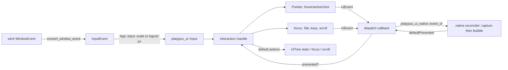
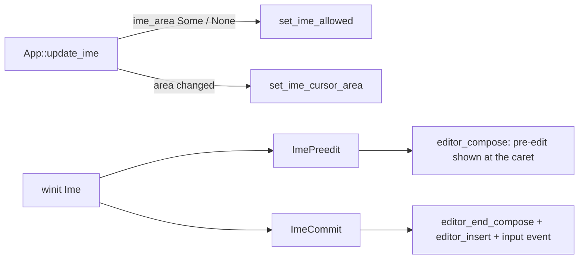

# Input and events

Crates: [platypus_platform](../crates/platypus_platform/src) (OS input),
[platypus_ui](../crates/platypus_ui/src) (`events.rs`, `interaction.rs`, hit testing in `tree.rs`), glue in
[platypus_app/main.rs](../crates/platypus_app/src/main.rs), the script side in [ui-native.md](ui-native.md) (`react.md` describes the deleted QuickJS reconciler). Test plan:
M3-EVT-* in [TESTS.md](../TESTS.md).

## End to end

## Platform layer

[input.rs](../crates/platypus_platform/src/input.rs) converts winit's `WindowEvent` to Platypus's own
`InputEvent` so nothing above this crate depends on winit:

- Keys use DOM naming: `code` is the physical key (`"KeyW"`, from winit's `KeyCode` debug name),
  `key` is the layout meaning (`dom_key`: characters as typed, `Space` -> `" "`, `Super` -> `"Meta"`,
  other named keys by their name), `text` is the typed text without control characters, plus `repeat`.
  `convert_key` is split out because winit's `KeyEvent` cannot be built in tests.
- Mouse: `MouseMove{x,y}` in **physical** pixels, `MouseDown/Up{button}`, `MouseLeave`, and
  `MouseWheel(WheelDelta)`. winit's wheel deltas are positive when scrolling up; the code negates
  them to the DOM convention (positive y = scroll down). `Lines` (notched wheels) and `Pixels`
  (touchpads) stay distinct.
- `Ime(ImeEvent)` for input methods: `Enabled`, `Preedit(text, cursor)` (cursor/selection as byte
  offsets, `None` hides the caret, empty text ends composing), `Commit(text)`, `Disabled`. winit only
  sends these after the app calls `set_ime_allowed(true)` (see below).
- `Modifiers`, `Resized`, `Focused`, `CloseRequested`.
- `MouseMotion { dx, dy }`: raw device movement from winit's `device_event`
  (`DeviceEvent::MouseMotion`). It is not clamped by the window's edges and keeps coming while the
  cursor is locked, which is what mouse look needs. `Platform` forwards it to `PlatformApp::input`.
- `WindowConfig.icon` (RGBA, width, height) becomes the window icon (`with_window_icon`);
  `CursorGrabMode` and `Icon` are re-exported for the app.
- `Gamepad { id, event: GamepadEvent }` (see [Gamepads](#gamepads-and-game-input-m3c-step-6)).

[platform.rs](../crates/platypus_platform/src/platform.rs): `Platform::run` owns the winit event loop.
`Runner` implements `ApplicationHandler`: creates the window in `resumed` (then
`PlatformApp::window_ready`), calls `PlatformApp::frame` on `RedrawRequested`, forwards converted
events to `PlatformApp::input`, and in `about_to_wait` checks `should_exit`, polls gamepads and
requests the next redraw (continuous rendering). `Platform::poll_gamepads` drains `gilrs` and
returns `InputEvent::Gamepad`s, which the runner feeds to `PlatformApp::input` like any other
event. `platypus_platform` re-exports `winit::dpi` so the app can build
IME area arguments.

Custom cursors need the event loop, so the app asks for them instead of creating them:
`PlatformApp::take_custom_cursor` (default `None`) returns a `CustomCursorRequest { key, image:
Option<CursorRgba> }`. The runner calls it after each frame, each input event and `about_to_wait`
(`Runner::update_cursor`). The first time it sees a `key` it builds a winit `CustomCursor` from the
RGBA pixels and hotspot (`CursorRgba`) and caches it in `cursors`; later requests with the same key
need no `image`. A rejected image is logged and skipped.

## App glue ([main.rs](../crates/platypus_app/src/main.rs))

`App::input` maps `InputEvent` to `platypus_ui::Input` and calls `handle_ui`:

- Positions are divided by `App::scale()`, the window DPI factor times the UI scale ([UI scale](#ui-scale)). `Lines` wheel deltas are
  multiplied by `WHEEL_LINE` (40 px), touchpad pixels are divided by scale.
- Buttons become DOM numbers via `dom_button` (0 left, 1 middle, 2 right, 3/4 back/forward).
  `PointerDown` carries `time_ms` (engine clock) for double-click detection.
- `Focused(false)` becomes `Input::WindowBlur`, so buttons held while the window was unfocused
  are forgotten (their release may never arrive).
- `handle_ui` calls `Interaction::handle(tree, input, &mut |event| dispatch(...))`, then
  `update_cursor`, which reads `Interaction::cursor_with_images` and acts only when the keyword,
  the image list or the window scale changed. It tries the `cursor: url(...)` images in order: the
  file is read from the game folder or a `data:` URL, decoded and cached by `url@scale`
  (`cursors_loaded`; `cursors_failed` warns once and moves on to the next image). The first that
  works becomes `custom_cursor` for the platform (see [Platform layer](#platform-layer)). With none,
  it falls back to the keyword (`set_cursor_visible(false)` for `none`; otherwise winit's
  `CursorIcon`). [cursor.rs](../crates/platypus_app/src/cursor.rs) decodes PNG, JPEG and `.cur` (an
  `.ico` of type 2 whose hotspot sits where `.ico` keeps colour planes). The hotspot is the CSS one,
  else the file's own, else the top-left corner. Images are scaled for the window's DPI and ones
  over `MAX_CURSOR_SIZE` (128px) are rejected.
- The native backend (`native.rs`) turns each `UiEvent` into an `Event` with `platypus_ui_native::event_of` and runs the
  compiled handlers (capture then bubble); it returns `true` only if a handler called `preventDefault()`. If the game
  has no handlers, nothing is dispatched but built-in behaviour (hover, focus, Tab) still works. (The QuickJS
  `__platypus_ui_event` call is gone; `UiEvent::script_args()` stays as the shared payload layout.)
- `KeyDown` forwards `text` (what the key types). `InputEvent::Ime` becomes `Input::ImePreedit` or
  `Input::ImeCommit`; `Ime::Disabled` becomes an empty `ImePreedit` (ends composing).
- After each `handle_ui`, `Interaction::take_clipboard()` is serviced and `update_ime` runs (see
  [Text fields](#text-fields-m3c-step-5)); `frame()` also calls `UiTree::set_time(now_ms)` (caret
  blink) and `update_ime` (the caret may have moved with layout).
- Script requests `focus`, `blur`, `scrollTo`, `scrollBy`, `scrollIntoView` (a behavior string as 4th arg) become
  `Input::Focus/Blur/ScrollTo/ScrollBy/ScrollIntoView` in `App::tick`. At the end of each tick the app sends `Input::Refresh`.

## Hit testing ([tree.rs](../crates/platypus_ui/src/tree.rs) `hit_test`)

`UiTree::hit_test(x, y)` first calls `layout_if_needed`, then `hit(ROOT, ...)` recursively:

- `position: fixed` nodes are tested first, in reverse paint order, ahead of the normal tree.
  `display: contents` nodes are never the target (their children are tested) but stay in event paths.
- Children are tested before their parent, **later siblings before earlier ones** (reverse paint
  order, i.e. `paint_order`: `zIndex`, then `order`, then DOM order). Children outside their parent's box can still hit (no automatic clipping unless the
  parent clips).
- Transforms: `hit` takes the window point and a `TransformContext`; each node maps the point into
  its own plane through the inverse homography (see [ui-tree.md](ui-tree.md#transforms)). A point
  behind the viewer, or a back-facing `backface-visibility: hidden` node, is a miss; children are
  tested with the window point and their own context.
- `visibility: hidden` (inherited, passed down as a `visible` flag) means the node itself is never
  the target, but its children are still searched and visible ones can hit.
- `display: none` returns nothing. The element's own `clip-path`/`clip` and, for children, its
  `overflow` clip must contain the point: **what is clipped away cannot be hit**, using the same
  `self_clips`/`overflow_clip` functions as drawing, so hit testing and painting stay in sync.
- `pointerEvents: none` is inherited and children can opt back in with `auto`.
- The element's own rounded rectangle is respected (`Rect::contains_rounded`).
- `text`/`span` children are not searched as boxes (`is_inline_container`). Once the text element
  itself is hit, `span_at` maps the point into its content box and asks `text::node_at` which run's
  characters are under it; the target is the innermost element around them, below the text element, skipping
  `#text`, generated content and `pointerEvents: none`. So an inline span is an event target
  (`onClick`, `:hover`, `cursor`) over its own characters and appears in event paths under its text;
  elsewhere the text element is hit (`M3-EVT-07`).
  Generated `::before`/`::after` nodes resolve to their originating element.
- `ROOT` never hits; the result `None` means "empty space".

`event_path(target)` returns the target first, then each ancestor, excluding the root: the exact
array sent to scripts.

## `Pointer` ([events.rs](../crates/platypus_ui/src/events.rs))

Holds the position (`None` when outside the window), the hovered `path`, held button bitmask,
per-button press targets, the `:active` path, the last press (for click counting) and modifiers.
Each method updates `:hover`/`:active` on the tree (via `update_state` -> `UiTree::set_state`, which
queues restyle keys, see [css.md](css.md)) and **returns the events to dispatch, in order**.

- `rehover` hit-tests and diffs paths: `pointerleave` for elements left (innermost first), then
  `pointerenter` for elements entered (outermost first), each with a one-element path since
  they do not bubble. Every ancestor on the path gets `:hover`, like CSS.
- `move_to` -> rehover + `pointermove`. `leave` clears the position.
- `down`: updates the buttons, records the press target, computes the click count (same target and
  button, within `DOUBLE_CLICK_MS` = 500 ms and `DOUBLE_CLICK_DISTANCE` = 4 px), sets `:active` on
  the whole path for the primary button, emits `pointerdown`.
- `up`: clears `:active`, emits `pointerup`, then `click` (primary), `dblclick` when the count is 2,
  or `contextmenu` (secondary). The click target is the **nearest element containing both the press
  and the release** (DOM semantics), so dragging off and back still clicks the common ancestor.
- `wheel(dx, dy)` -> rehover + `wheel` at the hovered path.
- `refresh` re-hit-tests without movement (the layout changed under a still cursor).
- `cancel` forgets held buttons (and any pointer capture).
- **Pointer capture.** `set_capture(tree, id)` makes `id` the target of moves and releases wherever
  the pointer is (drag a slider off its track). Like browsers it only works while a button is held
  and the element exists; capturing again moves the capture. `rehover` uses the capturer as the hit
  target while `capture` is set, so hover follows it too. Capture ends on `release_capture` for that
  element, when the last button is released (in `up`, after `pointerup`), when the element is removed
  or hidden (`refresh`), or on `cancel`. `release` emits `lostpointercapture` (if the element still
  exists) and `set_capture` emits `gotpointercapture`, both bubbling (`EventKind::GotPointerCapture` /
  `LostPointerCapture`); hover is re-evaluated after. Scripts reach it through
  `Input::SetPointerCapture(id)` / `ReleasePointerCapture(id)`, from the `setPointerCapture` /
  `releasePointerCapture` ops handled in `App::tick`, so they apply next frame. Tests: M3-EVT-06.

`UiEvent` carries the DOM-like fields (position, `button`, `buttons` bitmask 1/2/4/8/16, `detail`
click count, wheel deltas, modifiers, key/code/repeat, focus `related`, optional `ScrollInfo`).
`script_args()` builds `[type, path, data, strings?]` where `data` is a fixed-order number array:
`[x, y, button, buttons, detail, deltaX, deltaY, modifiers, repeat, related, scrollLeft, scrollTop,
scrollWidth, scrollHeight, clientWidth, clientHeight]`, with `strings = [key, code]` for keyboard
events and `[value]` for `input` events (`UiEvent.value`). The native `event_of` decodes by index (slots in `tables/events.rs`), so both must change together.

## `Interaction` ([interaction.rs](../crates/platypus_ui/src/interaction.rs))

`Interaction::handle(tree, input, dispatch)` is the single entry point (also used by tests, which
pass a closure that records events). It owns a `Pointer`, the focused node, modifiers, a
`keyboard` flag and scrollbar drag state. `dispatch` returns whether the script prevented the
default; **default actions run after the script sees the event**, like a browser.

| Input | Events sent | Default action (unless prevented) |
|---|---|---|
| `PointerDown` primary | `pointerdown` | Focus the nearest focusable ancestor on the path (inside the open modal, if any), else blur (a press on empty space blurs). `:focus-visible` is not set for pointer focus. Outside text fields it starts a static text selection (press, double and triple click) or clears one; dragging extends it |
| `PointerUp` | `pointerup`, `click`, ... | A click on the top modal's backdrop asks it to close when `closedBy="any"` and the click was not prevented |
| `Wheel` | `wheel` | Scroll the nearest scrolling ancestor (Shift turns vertical into horizontal) |
| `KeyDown` | `keydown` to the focused element only | `Escape` with an open modal: asks it to close (see [Dialogs](#dialogs)); `Ctrl/Cmd+C` with static text selected: `Clipboard::Copy`; `Tab`/`Shift+Tab`: move focus (sets `:focus-visible`); other keys scroll (arrows, Page, Space, Home/End) |
| `KeyUp` | `keyup` to the focused element | none |
| `Focus(id)` / `Blur(id)` (from `ref.focus()`) | `focusout` then `focusin` | `Focus` ignored if not focusable; `:focus-visible` only if the last focus move was by keyboard (browser heuristic) |
| `Navigate(dir)` | `focusout`/`focusin` (via `set_focus`) | The focused element first gets an `ArrowUp`/`ArrowDown`/`ArrowLeft`/`ArrowRight` `keydown`; if that is prevented focus stays (a list box moving its selection, `M9-VSP-10`). Otherwise moves focus to `nearest_in_direction` and scrolls it into view; nothing if no element has focus. Sets `:focus-visible` |
| `Activate` | `click` on the focused element | Skipped for text fields. No pointer position, `detail` 0 (like a keyboard-activated click) |
| `Refresh` | hover events, then queued `transition*`/`animation*` events (name in `value`, elapsed seconds in `delta_x`; see [animation.md](animation.md#events)) | drops focus from removed, hidden or disabled elements |

Focus details:

- `focusable(tree, id)`: has a tab index (`tab_index`: the `tabIndex` attribute, or 0 for text fields,
  which are focusable by default like in HTML), not `disabled`, `is_displayed` (no `display: none`
  ancestor) and not `visibility: hidden` (`computed_text(id).visible`). Plain `<box>`es without `tabIndex` are never focusable.
- `tab_order(tree)`: depth-first in tree order skipping generated nodes and `display: none`
  subtrees; positive `tabIndex` first (ascending, stable), then `tabIndex = 0` in tree order;
  negative values are skipped (focusable by click or `ref.focus()` only). `tab_target` wraps around.
- `set_focus` updates `ElementState.focus/focus_visible` and sends `focusout` (with `related` = the
  new target) to the old element, then `focusin` (with `related` = the old one). Both bubble, so
  `onFocus`/`onBlur` on a parent see descendants gaining/losing focus; `:focus-within` is handled
  by the cascade scanning descendants (`Deps.focus_within`). Compiled games and the native
  reconciler get the same events (`platypus_ui_native::event_of`), also `relatedTarget` (`data[9]`);
  `onFocus`/`onBlur` listen to `focusin`/`focusout`, not `focus`/`blur`, which are never sent.
- Key events with no focused element are not dispatched to UI handlers; gameplay code gets keys
  through the `input` API instead (see [Gamepads and game input](#gamepads-and-game-input-m3c-step-6)).

## Cursor

`CURSORS` in [style.rs](../crates/platypus_ui/src/style.rs) lists accepted keywords. `cursor` is
inherited by walking up from the hovered element (`UiTree::cursor`); `auto` means `text` over
selectable `text`/`span` (not under `user-select: none`) and `default` elsewhere. Enabled text
fields show the I-beam and disabled ones `not-allowed`.
`Pointer::cursor` -> `Interaction::cursor` -> the app (above).

`cursor: url(a.cur), url(b.png) 4 4, pointer` is parsed into `Visual.cursor_images`
(`Vec<CursorImage { url, hotspot }>`: an optional two-number hotspot per image, the keyword last
and required). `UiTree::cursor_with_images` (also on `Pointer` and `Interaction`) returns the
keyword plus those images. The app picks the first one that loads and hands it to the platform;
the keyword is the fallback. Bad lists are rejected like other invalid values.

### Script cursor (M5.a2)

Scripts' `Cursor` (Unity's names; the native `Cursor` API of `platypus_engine_api`) sets a `ScriptCursor { visible, lock, image }`
through the `cursor.*` requests of `App::cursor_op`:

- `cursor.visible bool` hides or shows the OS cursor over the window.
- `cursor.lock none|locked|confined` calls `set_cursor_grab` (`apply_cursor_lock`). `Locked` hides the
  cursor, and falls back to `Confined` where the platform cannot lock (Windows only confines). The
  grab is re-applied when the window regains focus.
- `cursor.image src|null [hotspot x y]` is the default cursor image, in the same formats and limits as
  CSS cursor images.

`update_cursor` combines them with the UI: `shown = script_cursor.visible && lock != Locked`, and the
script's image is used only where the UI asks for nothing special (no `cursor: url(...)` images and the
keyword `default`). A CSS `cursor` on an element always wins; `cursor: none` still hides it. Any
`cursor.*` op clears the cached cursor so the change shows at once.

## Dialogs

Tree side: [ui-tree.md](ui-tree.md#dialogs-and-the-top-layer-m3d-step-5j). `Interaction` adds:

- **Closing:** `request_close` sends `cancel` (cancelable, does not bubble) to the dialog and, only
  if `cancel` was not prevented, `close` (does not bubble). Scripts close the dialog by clearing
  `open`. Escape asks the top modal unless its `closedBy` is `none`. A click whose target is the
  top modal itself (its backdrop) and that lands outside its box (`to_local` against its rect) asks
  when `closedBy` is `any`. The default is `closerequest` (Escape only), as in HTML.
- **Focus** (`track_modals`, run after each input): when a modal opens, the element focused before
  it is recorded (`modals`) and focus moves to its first focusable descendant, else the dialog.
  When it closes or is removed, focus returns to the recorded element if that can still take it.
- **Scope** (`in_modal_scope`): everything outside the top modal is inert for pointer focus,
  `tab_order` (so Tab and d-pad navigation) and `Navigate`.
- `EventKind::Cancel` / `Close` reach scripts as `"cancel"` / `"close"`.

## Scrolling (M3c step 4b)

State and geometry live in `UiTree` ([ui-tree.md](ui-tree.md#scrolling)); `Interaction` supplies the
defaults. All scrolling goes through `Interaction::scroll(tree, id, x, y, by_user, dispatch)`: it
calls `UiTree::scroll_to`, and if the offset changed, lays out, dispatches a `scroll` event and
refreshes hover (content moved under the pointer).

| Trigger | Behaviour |
|---|---|
| `wheel` not prevented | `scroll_chain`: the first element on the path (innermost first) that can still move by the delta scrolls; otherwise the next ancestor takes over, unless the element that could not move has `overscroll-behavior: contain` (or `none`) on that axis (`UiTree::contains_overscroll`), which ends the chain. With Shift held and no `dx`, a vertical wheel scrolls horizontally |
| Keys (`key_scroll`, after `keydown` is not prevented) | Arrows scroll `SCROLL_LINE` (40 px), Page Up/Down and Space (Shift+Space up) scroll `SCROLL_PAGE` (0.875) of the visible height, Home/End jump. Origin is the focused element, else the hovered one; the first container on its path that moves wins, and `overscroll-behavior` stops the walk the same way |
| Tab / `ref.focus()` | instant (never smooth) `scroll_into_view` with `ScrollAlign::Nearest` on both axes: each scrolling ancestor scrolls just enough to show the element, keeping its start edge visible if it is larger than the viewport |
| Scrollbar press (primary button, checked **before** the page sees `pointerdown`) | `press_scrollbar` via `UiTree::scrollbar_at`: on the thumb it starts a drag (remembering the grab offset), on the track it pages toward the press |
| Pointer move while dragging | `drag_scrollbar` maps the thumb position back to an offset; `PointerUp` ends the drag |
| Scripts | `ScrollTo`, `ScrollBy`, `ScrollIntoView { block, inline }` inputs (`by_user = false`, so they also scroll `overflow: hidden`). `ScrollAlign` per axis, as the DOM's `ScrollLogicalPosition`: `Start` / `End` line up that edge with the container's, `Center` centres, `Nearest` is the focus behaviour above; each container is scrolled innermost first and clamped to its range (`M3-EVT-08`); `ScrollTo` treats NaN as "keep that axis", `ScrollBy` adds to `scroll_goal`. Each carries a `behavior` (`ScrollBehavior`: `Auto` follows the container's `scroll-behavior`, `Instant`, `Smooth`); smooth ones call `UiTree::smooth_scroll_to` instead (`scroll_into_view` allows for inner smooth scrolls not having moved yet) (`M3-EVT-09`). `scroll_into_view` shrinks each container's view (its padding box) by that container's `scroll-padding` (`UiTree::scroll_padding`) before aligning, so targets land clear of sticky headers and fades (`M3-EVT-10`) |

`Input::Refresh` dispatches `scroll` events for the containers `take_smooth_scrolled` lists, since smooth scrolls move on `set_time`, not on an input. Wheel, scrollbar drag and keys are instant: they go through `scroll_to`, which cancels a running smooth scroll.

User scrolling needs `overflow: scroll` or `auto` on that axis; `hidden` scrolls only from scripts;
`clip` and `visible` never scroll. The `scroll` event does not bubble and carries `ScrollInfo`
(`data[10..16]` = scrollLeft, scrollTop, scrollWidth, scrollHeight, clientWidth, clientHeight).

## Text fields (M3c step 5)

Model, sizing and drawing: [ui-tree.md](ui-tree.md#text-fields). `Interaction` routes input to the
focused field first, then falls back to the normal defaults.

**Keys.** After `keydown` is dispatched and not prevented, `UiTree::editor_key(focused, key, code, text,
modifiers)` runs `Editor::key` and returns a `KeyOutcome { handled, changed, copy, paste }`.
`handled` stops Tab handling and key scrolling, so a field consumes arrows, Home/End, Backspace,
Delete and printable keys. Unhandled keys (Tab, Escape, F-keys, Ctrl+other letters) fall through.
"Ctrl" below is Command on macOS (`ctrl || meta`); AltGr (reported as Ctrl+Alt) still types.
Shortcut letters match the DOM `key` when it is a Latin letter, otherwise the letter of the physical
`code` (`KeyA` gives A), so Ctrl+A/C/X/V work on Russian and other non-Latin layouts (`shortcut_key`).

| Keys | Action |
|---|---|
| Left / Right | Move; Shift selects; Ctrl moves by word |
| Up / Down | Textarea: move a line (Shift selects). Input: go to start / end |
| Home / End | Start / end of the line; Ctrl+Home/End (and any Home/End in an input) go to the text start / end; Shift selects |
| Backspace / Delete | Delete back / forward; Ctrl deletes a word |
| Enter | Textarea inserts a newline; an input does not handle it |
| Typed text | Replaces the selection; an input strips `\n` and `\r` |
| Ctrl+A | Select all |
| Ctrl+C / Ctrl+X | `copy` = the selected text; cut also deletes it (editable fields only) |
| Ctrl+V | `paste = true` (editable fields only) |

`readOnly` fields still move, select and copy but never change; `disabled` fields are inert (and not
focusable). When the text changed (compared before and after), `Interaction::input_event` dispatches
an `input` event (`EventKind::Input`, bubbles) with `UiEvent.value` = the new text.

**Pointer.** A primary press that is not prevented focuses the nearest focusable ancestor; if that is
a field, `editor_pointer` applies `PointerSelect::Press { clicks, shift }` using the DOM click count
(1 places the caret, Shift+1 extends, 2 selects a word, 3+ a line; in an input, all) and remembers
`selecting`. `PointerMove` while `selecting` sends `PointerSelect::Drag`; the primary `PointerUp`
clears it. Coordinates are absolute logical px, converted to the content box plus the field scroll.

**Values.** *Controlled* (React `value` prop): the attribute is the truth. Each edit sends `input`,
the handler sets state, and the new `value` comes back as `SET_ATTRS` (a no-op if equal, so the caret
is undisturbed). If the handler rejects the edit, React puts the old value back, see
[react.md](react.md#text-fields). *Uncontrolled* (`defaultValue` or neither): Rust keeps what was
typed and scripts read it from `input` events.

**Clipboard.** `platypus_ui` has no clipboard dependency. A copy, cut or paste key stores a
`Clipboard::Copy(text)` or `Clipboard::Paste` request on `Interaction`; the app calls
`take_clipboard()` right after `handle`. `Copy` is written with `arboard` (`App::clipboard()` opens
it lazily and logs a warning if unavailable). `Paste` reads the text and feeds it back as
`Input::Paste(text)`, which calls `editor_insert` on the focused field and sends `input` if the text
changed (read-only and disabled fields refuse; an input joins lines with spaces and drops a trailing line break, since copied lines often end in one).

**IME.** winit `Ime` -> `InputEvent::Ime` -> `Input::ImePreedit { text, cursor }` /
`Input::ImeCommit(text)`:

- `Interaction::ime_area(tree)` is `Some` only while an editable (not disabled, not read-only) field is
  focused: the candidate-window rectangle in absolute logical px (pre-edit text or caret, shifted by
  the field scroll). `update_ime` calls `set_ime_allowed` when that flips and `set_ime_cursor_area`
  when the rectangle changes.
- `ImePreedit` reaches the focused field only if it allows IME; empty text clears the composition.
  Pre-edit text lives in the Parley editor (`set_compose`), not in the value, so no `input` event is
  sent until the commit, and `set_value` is ignored while composing.
- `ImeCommit` first drops any pre-edit (`end_compose`), then inserts the text like a paste.
- Moving focus away mid-composition drops the pre-edit (`set_focus` calls `editor_end_compose`).

## Gamepads and game input (M3c step 6)

### Gamepads
[gamepad.rs](../crates/platypus_platform/src/gamepad.rs) turns `gilrs` events into
`InputEvent::Gamepad { id, event }`; `id` is stable while the pad is connected. `GamepadEvent` is
`Connected { name }`, `Disconnected`, `ButtonDown(name)`, `ButtonUp(name)`, `ButtonValue(name, 0..1)`
(analog triggers) and `Axis(name, -1..1)`. `Platform::poll_gamepads` announces pads already plugged in
at its first poll (some `gilrs` backends send no `Connected` for them); `announce_once` drops a repeat
`Connected` for a known pad and forgets pads on `Disconnected` (`M3-PAD-02`). Pads present at startup and newly connected ones are logged at info level (`log_pad`: name, vendor/product id, uuid hex). gilrs warns "No mapping found for UUID 0000..." for pads from Windows' gaming input (WGI) backend, such as Xbox controllers, which report an all-zero UUID; it is harmless, the driver provides the layout (`mapping_source()` is `Driver`). Names are fixed strings so scripts do not depend on
`gilrs`:

- Buttons (`button_name`): `South` (A), `East` (B), `West` (X), `North` (Y), `LeftBumper`,
  `RightBumper`, `LeftTrigger`, `RightTrigger`, `Select`, `Start`, `Mode`, `LeftStick`,
  `RightStick` (clicks), `DPadUp/Down/Left/Right` (plus `C`, `Z`).
- Axes (`axis_name`): `LeftStickX/Y`, `RightStickX/Y`, `LeftZ`, `RightZ`, `DPadX/Y`. Sticks are
  **y-up**: up and right are positive.
- Unknown buttons/axes, repeats, dropped events and force-feedback notices are ignored
  (`convert_gamepad` returns `None`).

### To scripts
`App::input` handles `Gamepad` events first and returns early. It gives them to the native backend
(`Native::game_input`) with the layout of `game_input::script_args(id, event)`
([game_input.rs](../crates/platypus_app/src/game_input.rs)); the `__platypus_input` JS call is gone:

| Event | Arguments |
|---|---|
| connected | `"gamepadconnected", id, name` |
| disconnected | `"gamepaddisconnected", id` |
| button down / up / analog | `"gamepadbutton", id, button, value` (1, 0, or 0..1) |
| axis | `"gamepadaxis", id, axis, value` |
| key down | `"keydown", code, key, repeat` |
| key up | `"keyup", code, key` |
| window lost focus | `"blur"` |

Key events are forwarded after the UI has handled them, **except while a text field has focus**
(`UiTree::is_editor`): typed keys stay the field's. Focus loss always sends `blur`.

### `input` (native API)
The native `input` of `platypus_engine_api` (the `input.ts` of `@platypus/engine` is deleted) keeps the state:

- `input.isKeyDown(code)` by physical `code` (`"KeyW"`).
- `input.gamepads()`, `input.gamepad(id)`: connected pads as `Gamepad { id, name, connected,
  buttons, axes }` (button values 0..1, axis values -1..1).
- `input.isButtonDown(name)`: any connected pad holds it (value above 0.5).
- `input.on(type, fn)` returns an unsubscribe function. Types: `keydown`, `keyup`,
  `gamepadconnected`, `gamepaddisconnected`, `gamepadbuttondown`, `gamepadbuttonup` (fired when a
  value crosses 0.5), `gamepadaxis`. A throwing listener is logged and the rest still run. The event fields are `InputEvent` (see `platypus-api.md`).
- `blur` clears held keys and zeroes pad buttons, since the releases may never arrive.

### The mouse for gameplay (M5.a2)

`App::input` also sends the mouse to the game's `input`, **before** and whatever the UI
does with it (so game code sees clicks over UI too; check the UI state yourself if that matters):

| Event | Arguments |
|---|---|
| move | `"mousemove", x, y` (UI pixels: window pixels divided by `App::scale()`) |
| button down / up | `"keydown", "MouseLeft" \| "MouseRight" \| "MouseMiddle" \| "Mouse<n>", "", false` and `"keyup", code, ""` |
| wheel | `"wheel", dx, dy` in lines (touchpad pixels divided by 40, about a line per 40 px like browsers) |
| raw motion | `"mousedelta", dx, dy` (only while the window has focus: `App::focused`) |

Raw `MouseMotion` events return after this and never reach the UI. Mouse buttons are ordinary keys in
the script's key state, so `input.isKeyDown("MouseLeft")` works.

The `input` state keeps `mousePosition`, and accumulates `mousedelta` and `wheel`
into pending sums that roll over once per tick with the key press sets, so `mouseDelta` and
`mouseScrollDelta` are this tick's totals. `mouseDelta` has y **up** positive (raw device y is down).
`getMouseButton(n)`, `getMouseButtonDown(n)` and `getMouseButtonUp(n)` use Unity's numbers (0 left,
1 right, 2 middle). `getAxis("Mouse X")` and `"Mouse Y"` are the delta times `0.1` (Unity's default
sensitivity), and `"Mouse ScrollWheel"` is the wheel's y times `0.1`. Lock the cursor with
`Cursor.lockState` for mouse look ([above](#script-cursor-m5a2)).

### UI navigation
`GamepadNav::ui_input(id, event)` in `game_input.rs` maps pad events to UI `Input`s: d-pad buttons
-> `Input::Navigate(Direction)`, `South` -> `Input::Activate`, and the left stick to `Navigate`
with hysteresis (pushed at |v| >= 0.6, released below 0.3, so one push moves once; the y axis is
up-positive; state is per pad and axis and dropped on disconnect). The app only sends these to
`handle_ui` while `Interaction::focused()` is set, so the d-pad stays the game's until UI takes
focus (e.g. a menu calling `ref.focus()`). The event is still sent to the game's `input` either way.

`nearest_in_direction(tree, from, direction)` ([interaction.rs](../crates/platypus_ui/src/interaction.rs))
considers the elements in `tab_order`, keeps those whose centre lies that way (more than 0.5 px
along the direction) and scores `along + 2 * |across|`, so elements in line beat closer ones off to
the side. The lowest score wins; there is no wrap-around.

## Drag and drop (M5.e)

[interaction/dnd.rs](../crates/platypus_ui/src/interaction/dnd.rs) adds HTML-style drag and drop to
`Interaction`; `dnd_input` sees each input first and takes the ones a drag changes.

- **Starting.** A primary press that scripts don't prevent, on an element with the `draggable`
  attribute (or inside one; not text fields or disabled elements), is remembered (`dnd_press`;
  it also skips starting a text selection). Once the pointer moves more than `DRAG_THRESHOLD`
  (4 px) with the button held, `dragstart` goes to that element. Preventing it cancels the drag
  and the move goes on as a normal one. Otherwise the press becomes a drag:
  `Pointer::cancel_press` drops `:active`, any pointer capture (`lostpointercapture`) and the
  click that would follow.
- **During.** Pointer events stop (`Pointer::set_position` moves without hit-testing, so
  `:hover` stays put). Each move sends `drag` to the dragged element, then, if the element under
  the pointer changed, `dragenter` to the new one and `dragleave` to the old one, then
  `dragover` to it. Its prevented flag is "accepted": the cursor is `grabbing` (or `copy` for
  files) when accepted, else `no-drop`.
- **Ending.** The release sends `drop` where the last `dragover` was accepted, else
  `dragleave`; then `dragend` to the dragged element with `detail` 1 if dropped. Then the button
  is released in `Pointer` (only enter/leave events go out: no `pointerup`, no `click`). Escape
  and `WindowBlur` cancel: `dragleave` and `dragend` with `detail` 0.
- **Drag image.** By default the dragged element itself, held where it was pressed:
  `UiTree::set_drag_image(id, dx, dy)` makes `draw_list` draw that subtree again at the end,
  inside `PushTransform` (a translation) and a `PushLayer` at 0.6 opacity. It is live, not a
  snapshot. `Input::SetDragImage { id, x, y }` (from `dataTransfer.setDragImage`, the
  `dragImage` op) picks another element, grabbed at (x, y), or none.
- **Files from the system.** `Input::FileDragEnter { files, x, y }`, `FileDrop { files }` and
  `FileDragCancel` run the same events without a dragged element (no `dragstart` / `drag` /
  `dragend`); the paths ride on every drag event as `UiEvent::files` (the `strings` argument for
  scripts).

**App side.** `platypus_platform` turns winit's `HoveredFile`, `DroppedFile` and
`HoveredFileCancelled` into `InputEvent::FileHovered/FileDropped/FileHoverCancelled` (one per
file). [file_drop.rs](../crates/platypus_app/src/file_drop.rs) gathers them and, once a frame
(`pump_file_drag`), sends the screen's UI `FileDragEnter`, then
`PointerMove`s while the cursor moves, then `FileDrop` or `FileDragCancel`. Windows sends the
window no cursor moves during a drag from another program, so the position comes from
`platypus_platform::cursor_in_window` (`GetCursorPos`); elsewhere it is the last pointer position.
(The editor host that used to receive the dropped paths is gone.)

**Scripts.** The native reconciler maps the seven events to `onDragStart`,
`onDrag`, `onDragEnter`, `onDragOver`, `onDragLeave`, `onDrop` and `onDragEnd` (all bubble;
`drag` and `dragover` have continuous priority). `PlatypusDragEvent` (a pointer event) has
`dataTransfer: PlatypusDataTransfer` and, for `dragend`, `dropped`. The transfer of an element drag
is one object from `dragstart` to `dragend` (`setData`/`getData`/`clearData`/`types`,
`dropEffect`, `effectAllowed`, `setDragImage`); for system files a transfer is made from the
paths, with `files: { path, name }[]` and `"Files"` in `types`. The data never crosses to Rust.
Games read the fields from the prelude class `UiDataTransfer` (see
[ui-native.md](ui-native.md)); `PlatypusDragEvent` is in the generated declarations with `PlatypusDataTransfer`
and `PlatypusDroppedFile`.

## UI scale

Screen UI is laid out in UI pixels and drawn bigger or smaller (s&box's ScreenPanel scaling), so a design for one
size fills any window the same. Games pick a mode with `UiScale` (`platypus_engine_api::ui_scale`, a
`#[platypus_api]` namespace): `UiScale.none()` (the default: one UI pixel per logical pixel), `UiScale.fixed(f)`,
`UiScale.height(1080)` (the window is that many UI pixels high) or `UiScale.fit(1920, 1080)` (that design fits inside
the window). A zero, negative or NaN size is ignored. The factor is clamped to 0.25..8 and is 1 for a minimised window.

The host reads the mode each time it sizes the screen (`ui_factor_for` in `main.rs`: the DPI scale times
`UiScale::factor` of the logical window size) on all three renderers (wgpu, GLES `gles_gfx.rs`, CPU `cpu_gfx.rs`);
`App::scale()` uses it for the layout size, the render target's `scale`, pointer and wheel positions and the IME
cursor area, and `Screen.width` / `height` are in UI pixels. A hot reload starts the new code unscaled (its top level
may set it again); a failed reload keeps the old code's. Tests `M3-GAME-02`, `M9-TS-3388`.
